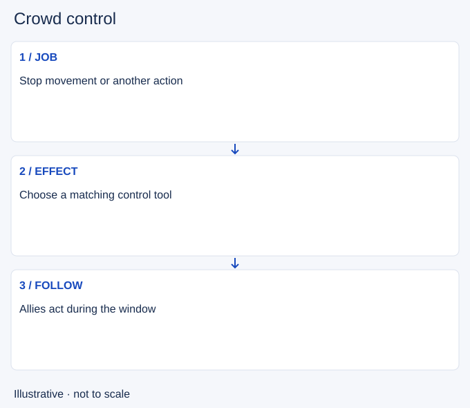

# Crowd control

- Stable lesson ID: MI21
- Slug: crowd-control
- Category: Micro
- Roles and level: All roles; beginner to intermediate.
- Summary: Use movement and action restrictions for a clear follow-up.
- Prerequisites: Skillshots.
- Observable action: Identify the action you need to stop.

## Short answer

Crowd control is an effect that restricts an enemy's movement or actions. Different types restrict different things; a slow, root and stun are not interchangeable.

## How it works

Choose the effect for the job: interrupt an approach, hold a target for damage or give an ally time to escape. Coordinate multiple effects so useful control is not wasted, while allowing overlap when immediate certainty matters. Check which actions the target can still take.

1. Identify the action you need to stop.
2. Confirm your effect can stop that action.
3. Use it when allies can exploit the result.

## Hypothetical example

An enemy approaches your carry. You use a movement restriction to delay them, but keep moving because they may still cast. Your teammate uses the space to retreat rather than standing still to attack.

<!-- Figure: MI21 -->

*Illustrative decision sequence for crowd control; arrows show decisions, not measured game positions or timing.*

## Common mistake and correction

**Mistake:** Assuming any control effect prevents every response.

**Correction:** Learn what your effect restricts and what remains possible.

## Practice

Review three control casts. Name the intended job and the action the target could still take. Note whether follow-up arrived during the useful window and one timing adjustment.

## Limits

Immunities, cleanses and spell-specific interactions matter. This lesson does not claim every channel or dash can be interrupted.

## Related lessons

[Skillshots](../micro/MI14-skillshots.md) · [Summoner spells](../micro/MI26-summoner-spells.md)

## Sources and limits

[Riot: Champion Counterplay](https://www.leagueoflegends.com/en-us/news/dev/quick-gameplay-thoughts-may-14/). Primary design context for tactical responses and champion strengths and weaknesses. It is not a current ability reference.

Checked 4 November 2026. The explanations, hypothetical scenarios, diagrams and exercises are editorial teaching guidance. Source context is not proof that a drill improves rank. No patch-specific numbers or independent expert review are claimed.
