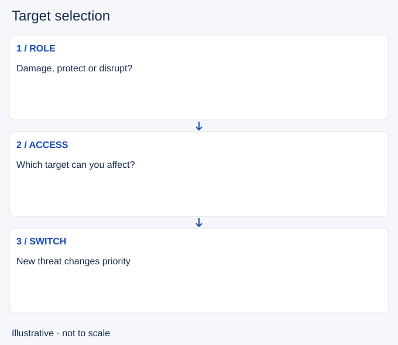

# Target selection

- Stable lesson ID: MI22
- Slug: target-selection
- Category: Micro
- Roles and level: All roles; beginner to intermediate.
- Summary: Choose a target you can affect without abandoning your job.
- Prerequisites: Positioning, Cooldown tracking.
- Observable action: Name your current job in the fight.

## Short answer

Target selection means deciding which enemy to damage or control at a given moment. The best target depends on access, threat and team purpose, not only on how much damage that enemy deals.

## How it works

Compare reachable targets with the cost of reaching others. A frontline enemy may be the useful damage target when walking past them would expose you. A diver threatening an ally may demand control even if another enemy is low. Reassess after movement or ability use changes access.

1. Name your current job in the fight.
2. Compare reachable threats and the cost of crossing.
3. Switch targets when the job or safe access changes.

## Hypothetical example

An enemy carry stands behind two defenders. You damage the closest defender from safety. When a diver reaches your ally, you switch to that immediate threat rather than walking toward the distant carry.

<!-- Figure: MI22 -->

*Illustrative decision sequence for target selection; arrows show decisions, not measured game positions or timing.*

## Common mistake and correction

**Mistake:** Chasing the highest-value enemy regardless of access.

**Correction:** Value safe, sustained contribution and protection as well as kills.

## Practice

Pause three fights before your first attack. List two possible targets and the cost of reaching each. Watch when that comparison changes and whether you update your choice.

## Limits

Target value is situational. This lesson does not prescribe always hitting the closest enemy.

## Related lessons

[Positioning](../micro/MI12-positioning.md) · [Cooldown tracking](../micro/MI15-cooldown-tracking.md) · [Body blocking](../micro/MI20-body-blocking.md)

## Sources and limits

[Riot: Champion Counterplay](https://www.leagueoflegends.com/en-us/news/dev/quick-gameplay-thoughts-may-14/). Primary design context for tactical responses and champion strengths and weaknesses. It is not a current ability reference.

Checked 4 November 2026. The explanations, hypothetical scenarios, diagrams and exercises are editorial teaching guidance. Source context is not proof that a drill improves rank. No patch-specific numbers or independent expert review are claimed.
