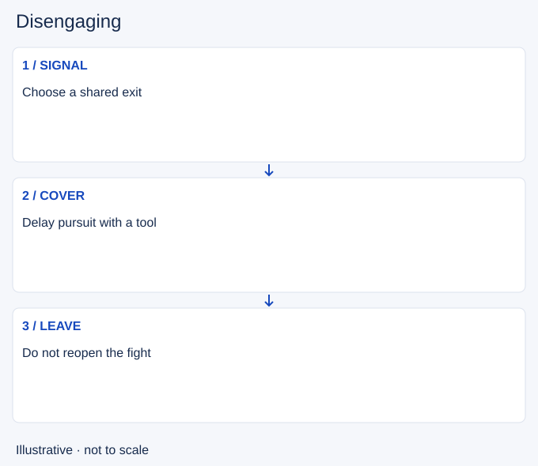

# Disengaging

- Stable lesson ID: MI23
- Slug: disengaging
- Category: Micro
- Roles and level: All roles; beginner to intermediate.
- Summary: End contact before the fight becomes harder to leave.
- Prerequisites: Peeling, Engaging.
- Observable action: Signal the retreat and choose a safe direction.

## Short answer

Disengaging means creating enough separation to stop or avoid a fight. It can use movement, control, terrain or a defensive ability, with the aim of reaching a safer position together.

## How it works

Choose an exit before spending your tools. A backward step can fail if it leads through another threat or leaves a slower ally behind. Sometimes a control spell should cover the retreat instead of starting a counterattack. Recheck whether the pursuers can still reach you.

1. Signal the retreat and choose a safe direction.
2. Use a suitable tool to interrupt pursuit.
3. Leave together instead of restarting for one more hit.

## Hypothetical example

Your team loses its frontliner before a contest. You slow the pursuers and move toward a visible route with your carry. You give up the objective rather than turn alone to poke again.

<!-- Figure: MI23 -->

*Illustrative decision sequence for disengaging; arrows show decisions, not measured game positions or timing.*

## Common mistake and correction

**Mistake:** Using the retreat tool and immediately re-entering range.

**Correction:** Treat separation as the objective until conditions change.

## Practice

Review three retreat attempts. Mark the chosen exit, the first covering ability and the teammate most at risk. Identify the moment another attack delayed escape.

## Limits

Some fights cannot be escaped after commitment. Earlier recognition may matter more than a better final cast.

## Related lessons

[Peeling](../micro/MI11-peeling.md) · [Engaging](../micro/MI13-engaging.md) · [Flanking](../macro/MA18-flanking.md)

## Sources and limits

[soduh / Dignitas: Poke Compositions](https://dignitas.gg/articles/team-composition-guide-to-poke-compositions-in-league-of-legends). Original coaching context distinguishing poke from siege and explaining disengage (2021). Historical builds, champion numbers and matchup prescriptions are excluded.

Checked 4 November 2026. The explanations, hypothetical scenarios, diagrams and exercises are editorial teaching guidance. Source context is not proof that a drill improves rank. No patch-specific numbers or independent expert review are claimed.
