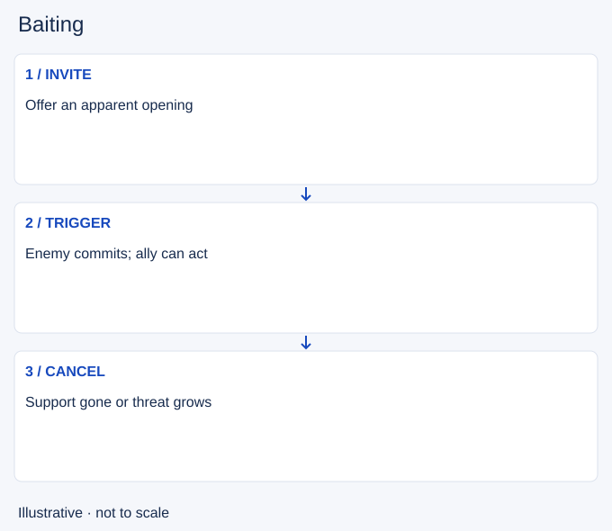

# Baiting

- Stable lesson ID: MI24
- Slug: baiting
- Category: Micro
- Roles and level: All roles; beginner to intermediate.
- Summary: Invite a commitment that your team is prepared to punish.
- Prerequisites: All-ins, Map awareness.
- Observable action: Define the enemy action you want.

## Short answer

Baiting means presenting an opportunity to encourage an enemy action you intend to punish. The apparent opening might be a vulnerable target or an objective start, but the plan needs a real response when the enemy commits.

## How it works

Check whether allies can act at the same time and whether you can survive the first response. The enemy may decline the invitation or bring more help than expected. Set a stop condition so waiting for the desired reaction does not become wasted time or a death.

1. Define the enemy action you want.
2. Confirm the punishment and your survival plan.
3. Cancel if allies leave or extra enemies arrive.

## Hypothetical example

You stand within reach while an ally waits nearby. The opponent does not advance and your ally must return to lane. You leave too, rather than keep offering the same opening after the support is gone.

<!-- Figure: MI24 -->

*Illustrative decision sequence for baiting; arrows show decisions, not measured game positions or timing.*

## Common mistake and correction

**Mistake:** Assuming hidden allies make any exposed position safe.

**Correction:** Check actual distance, readiness and enemy follow-up.

## Practice

Review one attempted bait. Write the intended trigger, available follow-up and cancellation condition before watching the result. Identify whether the enemy had a safer choice.

## Limits

The opponent controls whether they accept. A successful bait cannot be guaranteed from positioning alone.

## Related lessons

[All-ins](../micro/MI17-all-ins.md) · [Map awareness](../macro/MA39-map-awareness.md) · [Wave management](../macro/MA40-wave-management.md)

## Sources and limits

[Riot: Champion Counterplay](https://www.leagueoflegends.com/en-us/news/dev/quick-gameplay-thoughts-may-14/). Primary design context for tactical responses and champion strengths and weaknesses. It is not a current ability reference.

Checked 4 November 2026. The explanations, hypothetical scenarios, diagrams and exercises are editorial teaching guidance. Source context is not proof that a drill improves rank. No patch-specific numbers or independent expert review are claimed.
