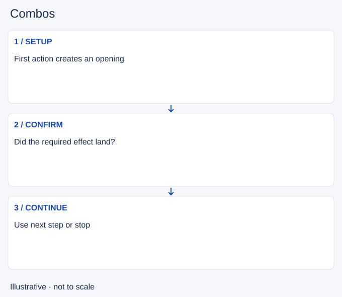

# Combos

- Stable lesson ID: MI25
- Slug: combos
- Category: Micro
- Roles and level: All roles; beginner to intermediate.
- Summary: Sequence abilities and attacks around the effect you need.
- Prerequisites: Skillshots, Cooldown tracking, Resource management, Crowd control.
- Observable action: Choose a result and a simple sequence.

## Short answer

A combo is a planned sequence of attacks and abilities intended to produce a result, such as reliable damage, control or escape. A useful sequence accounts for what the opponent can do between its parts.

## How it works

Learn a simple sequence for your champion, then identify its purpose and failure points. Some sequences require a hit before the next cast, while others should stop when the target moves away. Preserve a defensive tool when spending it would make the result unsafe.

1. Choose a result and a simple sequence.
2. Check each required hit or position.
3. Continue only while the next step remains useful.

## Hypothetical example

You plan to land control before a damage spell. The first cast misses, so you keep the second ability for wave clear instead of firing it automatically at an enemy who can now move freely.

<!-- Figure: MI25 -->

*Illustrative decision sequence for combos; arrows show decisions, not measured game positions or timing.*

## Common mistake and correction

**Mistake:** Finishing a memorised sequence after its setup fails.

**Correction:** Treat each step as a decision with a visible condition.

## Practice

Use practice mode to repeat a simple champion sequence five times. Then deliberately miss the setup and practise stopping. In a replay, compare one completed sequence with one you should have cancelled.

## Limits

Champion mechanics differ and can change. Verify current ability behavior in game; this is not a universal optimal combo.

## Related lessons

[Skillshots](../micro/MI14-skillshots.md) · [Cooldown tracking](../micro/MI15-cooldown-tracking.md) · [Resource management](../micro/MI16-resource-management.md) · [Crowd control](../micro/MI21-crowd-control.md) · [Trading](../micro/MI06-trading.md)

## Sources and limits

[Riot: Champion Counterplay](https://www.leagueoflegends.com/en-us/news/dev/quick-gameplay-thoughts-may-14/). Primary design context for tactical responses and champion strengths and weaknesses. It is not a current ability reference.

Checked 4 November 2026. The explanations, hypothetical scenarios, diagrams and exercises are editorial teaching guidance. Source context is not proof that a drill improves rank. No patch-specific numbers or independent expert review are claimed.
