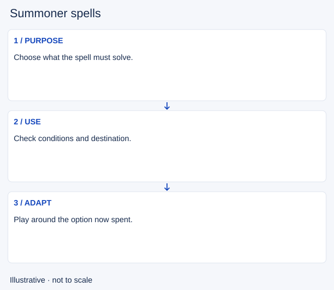

# Summoner spells

- Stable lesson ID: MI26
- Slug: summoner-spells
- Category: Micro
- Roles and level: All roles; beginner to intermediate.
- Summary: Plan a spell’s purpose and the options left after using it.
- Prerequisites: Cooldown tracking, Crowd control.
- Observable action: Read the effect, restrictions and availability of your own spell.

## Short answer

Summoner spells are additional abilities selected for a match, separate from your champion’s own kit. Their availability can change whether an escape, chase or team action is feasible.

## How it works

Read your selected spells in the current client and check your own displayed cooldowns. Give each spell a purpose before a dangerous action: reaching safety, supporting a commitment or serving your role’s task. Compare the expected benefit with what becomes harder while it is unavailable. Do not spend a spell only because you have already started chasing. Conversely, saving it until no useful escape remains can waste the opportunity it offered.

1. Read the effect, restrictions and availability of your own spell.
2. Choose the problem it must solve and a useful destination or target.
3. After using it, adjust your position and next commitment to the missing option.

## Hypothetical example

Your movement spell is ready and an enemy approaches. In this hypothetical case, the spell can reach a safer position near allies. You use it before the escape closes, then play farther back while it is unavailable. Later, you decline a chase that would need that same escape. No particular wall crossing or crowd-control interaction is assumed.

<!-- Figure: MI26 -->

*Illustrative choices for summoner spells; not measured game timing or positions.*

## Common mistake and correction

**Mistake:** Treating a ready spell as a guarantee of escape, or assuming an enemy’s spell is down without seeing it used.

**Correction:** Check the specific interaction; record observed enemy use separately from estimated return time.

## Practice

Review three uses or missed chances to use one selected spell. Before seeing the outcome, write its intended purpose, the needed conditions and the next action you must avoid while it is unavailable. Rehearse one unfamiliar use in practice mode using current client descriptions.

## Limits

Spell availability, upgrades, restrictions and cooldown modifiers vary by mode and setup. This is not a spell loadout recommendation or a complete interaction reference. Enemy timing estimates retain uncertainty.

## Related lessons

[Cooldown tracking](../micro/MI15-cooldown-tracking.md) · [Crowd control](../micro/MI21-crowd-control.md) · [Combos](../micro/MI25-combos.md)

## Sources and limits

[Riot: How to Play](https://www.leagueoflegends.com/en-us/how-to-play/) identifies summoner spells as additional champion tools. Specific effects and restrictions must be checked in the current client; the use-and-reassess routine is editorial guidance.

Checked 4 November 2026 (Pacific time). Examples and exercises are editorial teaching proposals, not validated rank-improvement methods.
